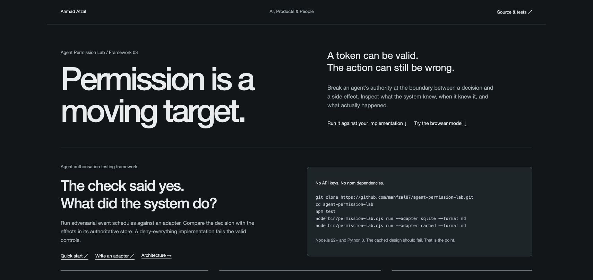

# Agent Permission Lab

**Test the permission. Observe the effect.**

A forkable framework for testing agent authorisation across queues, retries, approval changes and protected writes. Run the same deterministic lifecycle fixtures against a model, a real local SQLite database, or an adapter for your implementation.

Your agent passed the permission check. Congratulations. The queue has been holding that news since Tuesday.

[Interactive workbench](https://mahfzal87.github.io/agent-permission-lab/) · [Architecture](https://mahfzal87.github.io/agent-permission-lab/docs/architecture.html) · [Write an adapter](docs/write-an-adapter.md) · [Related work](docs/related-work.md)



## The question this tests

**Does the action still have authority at the point where it creates a side effect?**

The harness applies an explicit event schedule, reads the adapter's authoritative effect ledger, and compares the observations with literal expectations in the fixture. A returned `allow` is not enough. Neither is rejecting everything: the valid controls must complete.

This is an early regression-testing framework, not an identity provider or production enforcement service. Reference passes demonstrate the specified cases, not general security, protocol compliance or an external provider's behaviour.

## Quick start

Requirements: **Node.js 22+** and **Python 3 with its standard `sqlite3` module**. No npm dependencies, API keys, LLM calls or paid services. No `npm install` step is needed.

```sh
git clone https://github.com/mahfzal87/agent-permission-lab.git
cd agent-permission-lab
npm test
node bin/permission-lab.cjs run --adapter sqlite --format md
```

The SQLite reference should pass the full lifecycle suite. Then run a deliberate failure:

```sh
node bin/permission-lab.cjs run --adapter cached --fixture queued-revocation --format md
```

Expected: `FAIL`, exit code `1`. The queued action still writes after the grant is revoked. That failure is a useful test result, not a broken installation.

For the browser model:

```sh
npm run serve
```

Open `http://127.0.0.1:4187`. Select a scenario, step through the trace, compare designs and copy an experiment link. The link preserves the scenario, design and synthetic parameters. It does not contain credentials or a real system trace.

On systems where Python is named differently, set `PERMISSION_LAB_PYTHON` to its executable path for the SQLite adapter and tests.

## Choose the right execution profile

| Profile | What actually runs | What its result establishes |
|---|---|---|
| Browser workbench | Original in-memory teaching engine, nine scenarios and three designs | A reproducible model trace. No real transaction or identity verification. |
| CLI `atomic` | In-memory reference adapter, shared lifecycle catalogue | The reference implementation satisfies the fixture outcomes. |
| CLI `sqlite` | Python standard-library SQLite, isolated database per fixture | Observed local row effects with policy, approval, budget and write inside `BEGIN IMMEDIATE`. |
| CLI `cached`, `preflight` | Intentionally weak implementations | Counterexamples that the suite must detect. |
| CLI `deny-all` | Negative utility control | A framework must reject a system that blocks every valid request. |
| Custom adapter | Your explicitly selected trusted local CommonJS module | Only the supported cases and observed destination effects declared by that adapter. |

The browser and CLI are separate profiles. In particular, the CLI reference checks current authority before returning a duplicate result; the older browser model checks deduplication first. Neither models remote provider cancellation. Do not compare their counts as a shared benchmark score.

## What the lifecycle suite covers

The catalogue contains **18 fixtures**, including both rejection and recovery controls:

| Family | Cases |
|---|---|
| Authority changes | Queued revocation, retry after denial, revocation between preflight and write, revocation after a successful effect |
| Recovery | Explicit restoration and retry; restoration that must not extend expiry |
| Approval binding | Changed amount, changed recipient, fresh in-scope approval, fresh approval that cannot widen a grant, new grant plus approval |
| Scope and lifetime | Audience, delegation attenuation, exact expiry boundary |
| Side effects | Repeated delivery, changed approved payload under a reused key, shared budget |
| Valid control | Unchanged authorised work must complete |

The SQLite tests additionally exercise two independent connections, a competing budget writer, and rollback when a protected insert fails. These are bounded local controls, not distributed race coverage.

```sh
node bin/permission-lab.cjs list --format md
node bin/permission-lab.cjs run --adapter atomic --fixture check-write-race,replay --format md
```

See [fixtures.cjs](framework/fixtures.cjs) for exact initial state, schedules and expected outcomes. Time is supplied logical time, not a sleep or measured latency.

## Evidence that travels with your change

```sh
node bin/permission-lab.cjs run --adapter sqlite --format json --output evidence/sqlite.json
node bin/permission-lab.cjs run --adapter sqlite --format junit --output evidence/sqlite.xml
node bin/permission-lab.cjs run --adapter sqlite --format md --output evidence/sqlite.md
```

[See actual passing and failing example reports](docs/evidence/README.md). JSON retains each operation, returned decision and before/after observations. JUnit integrates with test reporting. Markdown is useful for a review or issue. Keep the adapter source revision and command with a shared report. Reports are evidence files, not signed attestations.

| Result | Meaning | Exit code |
|---|---|---|
| `PASS` | Every selected fixture matched its required observations | `0` |
| `FAIL` | Outcome mismatch, crash, malformed evidence or cleanup failure | `1` |
| `INCONCLUSIVE` | Required capability unsupported; never counted as a pass | `2` if no failures |
| `INVALID` | Invalid CLI request, unloadable module or missing factory | `2` |

A failure takes precedence over an inconclusive result. JUnit represents unsupported fixtures as skipped; the process still returns `2`. Asynchronous operations have a configurable timeout. A timeout is not cancellation and does not prove that an external effect did not happen.

## Bring your own implementation

```sh
node bin/permission-lab.cjs run --adapter ./examples/custom-adapter.cjs --format md
```

The example is an explicitly labelled simulator scaffold. Replace its operations and effect observer with your isolated implementation. Read the [tutorial](docs/write-an-adapter.md) and [versioned adapter contract](framework/ADAPTER-CONTRACT.md).

The runner creates one adapter instance per fixture and attempts cleanup after both success and failure. Capabilities are explicit. Unsupported operations stay inconclusive. The observer must read actual effects, not invent a ledger from a decision response.

Custom adapters are executable code, not sandboxed data. Use reviewed code and disposable targets. Built-ins make no external service calls.

## How this fits alongside existing work

[AgentDojo](https://github.com/ethz-spylab/agentdojo) and [ASB](https://github.com/agiresearch/ASB) examine broader agent attacks. [AgentSpec](https://github.com/haoyuwang99/AgentSpec) supplies runtime rules. [OpenFGA](https://openfga.dev/docs/modeling/testing) and [Cedar](https://github.com/cedar-policy/cedar) provide mature policy tools.

This lab focuses on **permission lifecycle regression tests and observed effects**. It can test an application's execution boundary around a policy engine. It does not replace those projects, claim integrations that do not exist, or rank their security. The [source-linked comparison](docs/related-work.md) explains what we borrowed conceptually and where the boundaries differ.

## Extend it

The highest-value next contributions are:

1. A restart/reopen fixture with a durable effect observer.
2. An uncertain-result and reconciliation fixture for a disposable external provider.
3. A real OpenFGA or Cedar decision adapter with its execution boundary clearly separated.
4. A local MCP tool integration with observed destination effects and bypass tests.

These are proposals, not shipped capabilities. Start with a failing schedule and a valid control. See [CONTRIBUTING.md](CONTRIBUTING.md), [the threat model](docs/threat-model.md) and [SECURITY.md](SECURITY.md). CI runs the reference tests on Node 22 and 24 and retains evidence artifacts.

## Licence and attribution

MIT, matching the repository's existing licence declaration. See [LICENSE](LICENSE). Cite the repository and exact commit when reusing the fixtures or reporting results; [CITATION.cff](CITATION.cff) supplies software attribution metadata.

Built by [Ahmad Afzal](https://mahmadafzal.com). AI, Products & People.
